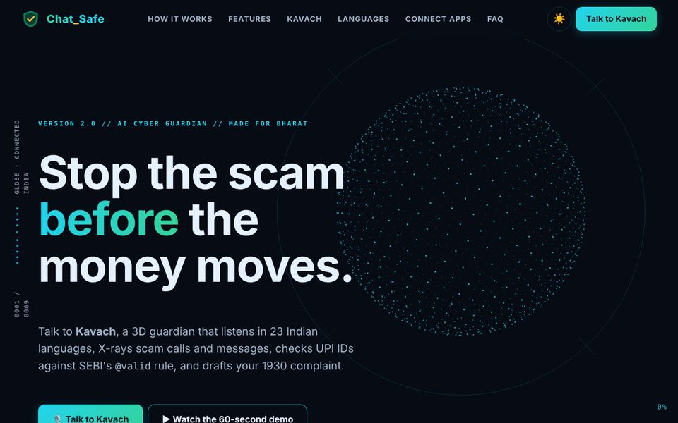
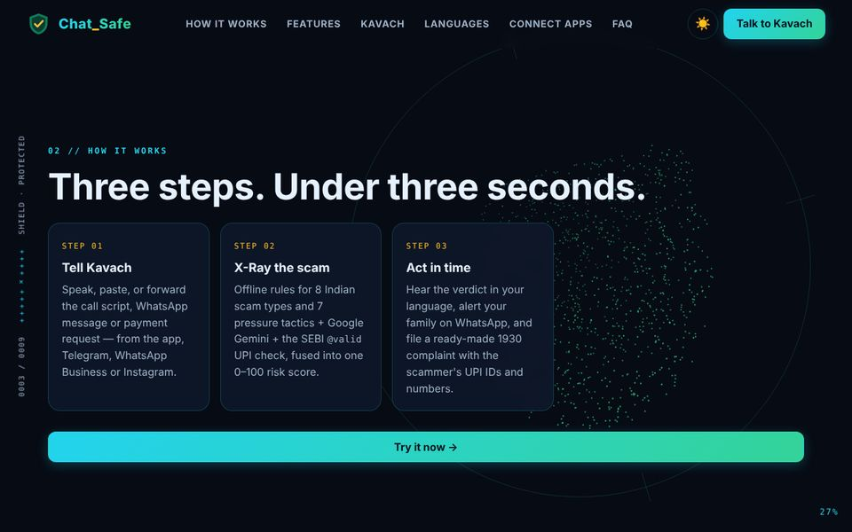
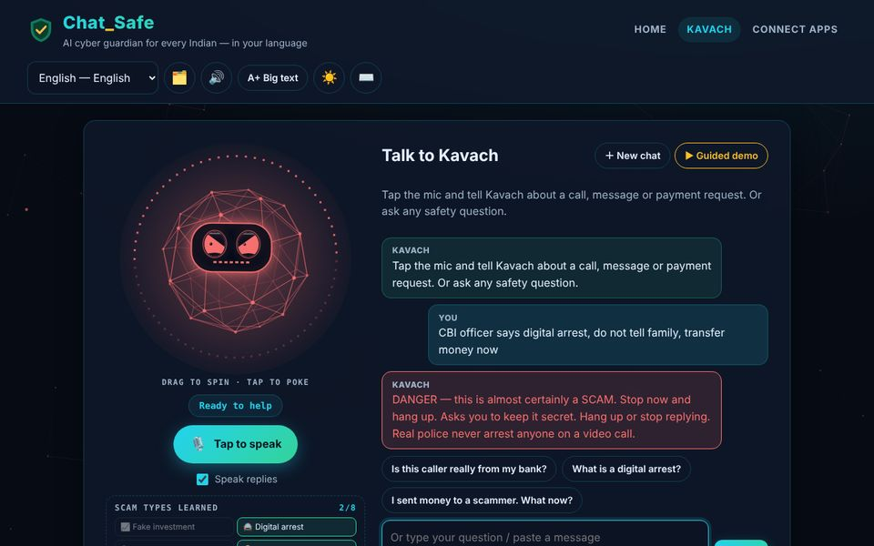
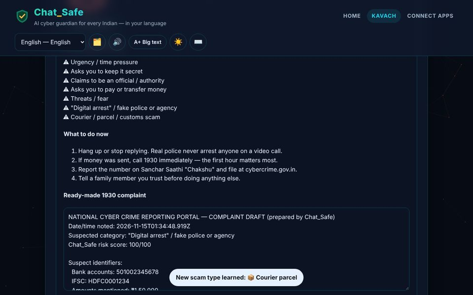
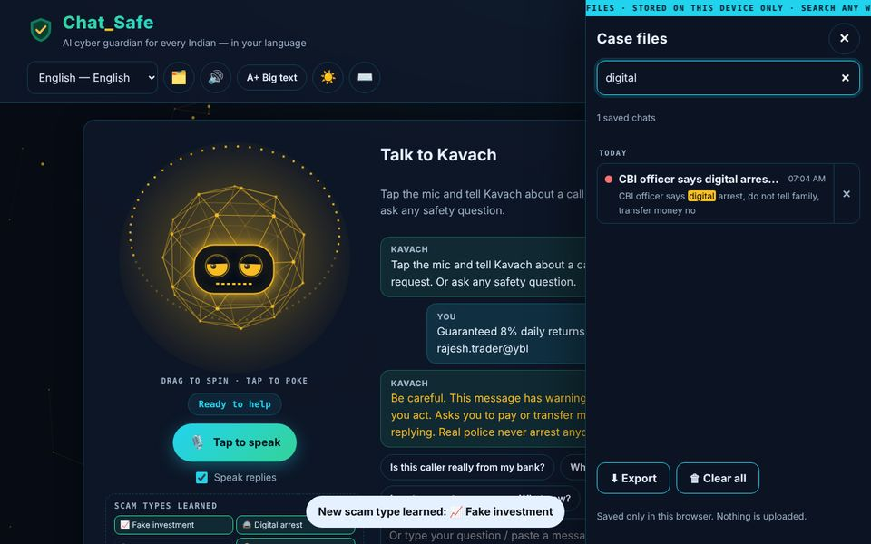
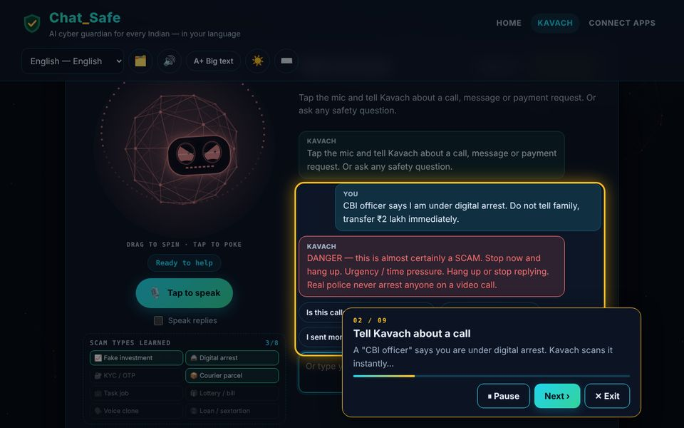
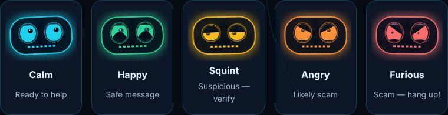
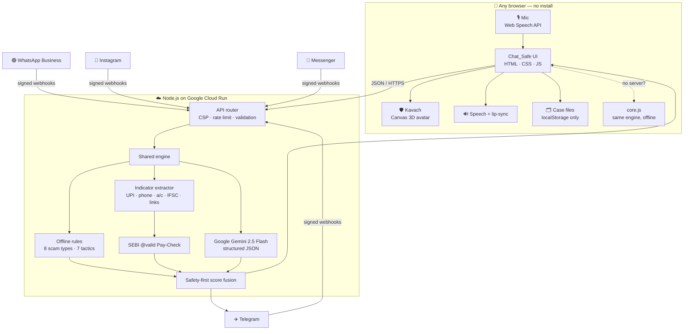

# 🛡️ Chat_Safe 2.0 — AI cyber guardian for every Indian

**PromptWars X Noor AITH — Build for Impact** · Domains: *Cybersecurity & Digital Safety* + *Accessibility & Inclusion*

Talk to **Kavach**, a 3D cyber guardian, in **English or any of India's 22 scheduled languages**. Speak, paste or forward a suspicious call, WhatsApp message or payment request — Kavach scans it, shows the danger **in its eyes**, speaks the verdict aloud and drafts your 1930 complaint. No reading skill, no app install and no API key required.

### ▶ Try it now — no installation
**Live web version: https://g-jayakiruthika.github.io/Chat_Safe/**
The same detection engine runs inside the browser, so judges can open the link and use everything immediately. Nothing is uploaded; chats stay on the device.

      

| Landing — scroll-driven 3D | Scroll morph: globe → attack → shield | Kavach reacts to a scam |
|---|---|---|
|  |  |  |
| **Scam X-Ray result + 1930 draft** | **Case files: saved chats + search** | **Guided demo for judges** |
|  |  |  |

**Kavach's eyes change with the threat level — readable without any text:**



---

## 1. The problem

- Indians lost **₹19,812 crore** to cyber fraud in 2025 across **21.7 lakh complaints** (I4C / National Cyber Crime Reporting Portal data, as reported in the press).
- **77%** of that loss came from **fake investment groups**; "digital arrest" was 8%.
- Telcos already block spam *calls* at network level. But a WhatsApp group that asks you to pay a **personal UPI ID** gets through — and almost every warning is written in English text that the most vulnerable users cannot read.

**Chat_Safe's answer:** a guardian you can *talk to* in your own language, that checks **messages and payments**, lives **inside the chat apps people already use**, and shows danger through **colour and eyes** instead of text.

## 2. Features — and where to find them

| # | Feature | Where | What it does |
|---|---|---|---|
| 1 | **Kavach voice agent** | `app.html` | Tap the mic, speak in any supported language. Speech → text → scan or answer → speech, with a lip-synced 3D avatar. Drag to spin it, tap to poke it, press `S` for a safety tip. |
| 2 | **Scam X-Ray** | `app.html` → *Scan a message* | 0–100 risk score, scam type, and the exact pressure tactics (urgency, secrecy, authority, fear, OTP requests, payment asks, greed). |
| 3 | **Pay-Check** | `app.html` → *Check before you pay* | Verifies a UPI ID against SEBI's `@valid` handle rule for registered brokers, advisers and mutual funds (live since 1 Oct 2025). |
| 4 | **Kamala Paati decoy** | `app.html` → *Paati decoy* | An AI grandma who wastes scammers' time and never shares real data (inspired by Virgin Media O2's *dAIsy*). |
| 5 | **1930 complaint draft** | after any risky scan | Auto-extracts the scammer's UPI IDs, phone numbers, bank accounts, IFSC codes, amounts and links into a ready-to-paste complaint. |
| 6 | **Family alert** | after any risky scan | One tap sends a WhatsApp warning to a relative. |
| 7 | **Case files** | `app.html` → 🗂️ | Every chat saved **on the device only**. Search any word with highlighted matches, grouped by Today / Yesterday / date. Export or delete. |
| 8 | **Chat-app connectors** | `connect.html` | Telegram bot, WhatsApp Business, Instagram DM, Messenger, plus the Android share sheet. |
| 9 | **Guided demo** | `app.html?demo=1` or `D` | A self-playing 9-step tour with spotlight, captions, progress bar and Pause / Next / Exit. |
| 10 | **Learning HUD** | `app.html` | "Scam types learned 0/8" unlocks as you meet each scam, with a sound and a toast. |
| ★ | **Works offline / zero-install** | everywhere | The same engine is bundled to `core.js` and runs fully in the browser when there is no server or API key. |

### Accessibility and privacy
| Area | What is implemented |
|---|---|
| **No reading needed** | Colour + eye expression + spoken verdict in the user's own language. |
| **Low vision** | `A+ Big text` mode, light/dark themes, 46px+ touch targets, high-contrast colour tokens. |
| **Screen readers** | Skip link, WAI-ARIA tabs with arrow keys, `role="meter"` gauge with `aria-valuetext`, `aria-live` chat and status regions, labelled canvases. |
| **Motor / keyboard** | Full keyboard control with shortcuts (`M`, `/`, `S`, `H`, `N`, `T`, `D`, `?`, `Esc`) and a shortcuts dialog. |
| **Motion sensitivity** | Every animation respects `prefers-reduced-motion`. |
| **Privacy** | Chats are stored only in the browser's `localStorage`. The server keeps nothing; the AI only ever receives the one message being checked. |

## 3. How Chat_Safe 2.0 works

### 3.1 Architecture



### 3.2 One message, step by step

```mermaid
sequenceDiagram
  actor U as User
  participant B as Browser
  participant K as Kavach
  participant S as /api/agent
  participant G as Gemini
  U->>B: Taps 🎙️ and speaks (e.g. Tamil)
  B->>K: listening — wide eyes, sonar rings
  B->>B: SpeechRecognition (ta-IN) → text
  B->>K: thinking — fast spin, eyes look up, scan line
  B->>S: POST {text, lang:"ta"}
  S->>S: Rules engine quick score
  alt Scam-like (score ≥ 30)
    S->>G: Analyse suspect text (JSON schema)
    G-->>S: risk_score · scam_type · red_flags · steps
    S->>S: Fuse scores · extract UPI/phone · SEBI check · draft 1930 complaint
    S-->>B: mode "scan" · mood "critical" · full analysis
  else General safety question
    S->>G: Answer as Kavach, 3 spoken sentences in Tamil
    G-->>S: reply
    S-->>B: mode "chat"
  end
  B->>K: mood colour + eye expression (+ shake if critical)
  B->>U: Speaks the reply; mouth bars move on every word
  B->>B: Saves the exchange to case files (device only)
```

### 3.3 The scoring logic

1. **Rules engine** (`src/rules.js`) — regular expressions for **8 Indian scam categories** and **7 pressure tactics** in English, Hindi, Tamil, Hinglish and Tanglish. Each match adds weight; extra hits inside one category add more.
2. **False-positive guard** — a scam keyword with *no* pressure tactic is damped: ×0.5 for a single lone keyword (news articles, safety warnings) but only ×0.85 when the same category matched twice, because that is a real pattern.
3. **Indicator extractor** (`src/extract.js`) — UPI IDs, phone numbers, bank accounts, IFSC codes, amounts, link shorteners, Telegram invites and `.apk` downloads. Risky indicators add to the score.
4. **Gemini** reads the message in any language and returns a schema-checked JSON verdict.
5. **Safety-first fusion** — if either engine is ≥ 80 confident, the **higher** score wins; otherwise 40% rules + 60% AI.
6. **Levels** — `0–29 safe` · `30–59 suspicious` · `60–79 high` · `80–100 critical`.

### 3.4 How the 3D avatar works (no libraries)

`public/avatar.js` is a 3D engine written from scratch in Canvas 2D:

1. Builds an **icosphere** — a 20-sided icosahedron subdivided once into 42 vertices and 120 edges — as Kavach's shield head.
2. Each frame it **rotates** every vertex with Y/X rotation matrices and applies **perspective projection** (`scale = d / (d − z)`); edges closer to the viewer are drawn brighter (depth shading).
3. A tilted **ring of 72 particles** orbits the head, and the **visor face** follows your pointer.
4. **Eyes are drawn as a shaped clip region**: a glowing sclera, a pupil that tracks the pointer, and an upper eyelid whose inner and outer ends drop *independently* — that one trick produces calm, happy, squinting, angry and furious expressions.
5. **States**: idle · listening (wide eyes, sonar rings) · thinking (eyes look up, scan line) · speaking (7-bar mouth equaliser driven by `SpeechSynthesisUtterance.onboundary`).
6. **Interaction**: drag to spin with inertia, tap or press Enter to poke (surprised eyes + a tip), and it pauses drawing when scrolled off-screen.

### 3.5 Scroll-driven background (`public/morph.js`)

1,200 particles morph between six cybersecurity shapes as you scroll the landing page:

| Section | Shape | Meaning |
|---|---|---|
| Hero | **Globe** | A connected India |
| The problem | **Attack burst** | Scams spreading (turns red) |
| How it works | **Shield** | Protection (turns green) |
| Features | **Padlock** | Secured (turns amber) |
| Languages | **Torus ring** | 23 languages orbiting |
| Kavach / CTA | **Eye** | The guardian watching |

Each shape is generated mathematically (Fibonacci sphere, rounded box + half-torus, almond eye). The scroll position between two sections blends the two point clouds and their colours, with a small outward "data scatter" during the transition.

### 3.6 Languages

English plus all 22 languages of the **Eighth Schedule**: Assamese, Bengali, Bodo, Dogri, Gujarati, Hindi, Kannada, Kashmiri, Konkani, Maithili, Malayalam, Manipuri, Marathi, Nepali, Odia, Punjabi, Sanskrit, Santali, Sindhi, Tamil, Telugu, Urdu.

| Layer | English · தமிழ் · हिन्दी | Other 20 languages |
|---|---|---|
| Menus and buttons | Fully translated | English (an on-screen note explains this) |
| Kavach replies, verdicts, Paati | Gemini + offline fallback | Gemini replies in the native script; English offline fallback |
| Voice in / out | Browser speech engine | Where the device has that voice; otherwise the reply is shown as text |
| RTL scripts (Urdu, Sindhi, Kashmiri) | — | Replies render right-to-left via `dir="auto"` |
| **Auto-detect** | — | Pick 🌐 *Auto-detect* and the script of your message chooses the language — this is also how the chat-app bots answer |

## 4. Programming languages & technologies

| Language / tech | Where | Why |
|---|---|---|
| **JavaScript (Node.js 20+, CommonJS)** | `server.js`, `src/*.js`, `tools/*` | One language front and back; built-in `node:http`, `node:crypto`, `fetch` and `node:test` mean **zero npm dependencies** — nothing in the supply chain to attack |
| **JavaScript (browser, ES2020)** | `public/*.js` | UI, 3D avatar, scroll morph, voice agent, case files, guided demo |
| **HTML5** | `public/*.html` | Semantic, accessible structure (ARIA tabs, live regions, meter, dialog) |
| **CSS3** | `public/styles.css`, `landing.css` | Theme tokens for light/dark, glassmorphism, keyframe animations, responsive grid, `prefers-reduced-motion` |
| **Regular expressions** | `src/rules.js`, `src/extract.js` | Multilingual scam patterns and identifier extraction |
| **JSON / JSON Schema** | Gemini `responseSchema` | Structured, validated AI output |
| **Web Audio (synthesised)** | `public/sound.js` | Alert, scan and unlock sounds with no audio files |
| **Dockerfile** | `Dockerfile` | Non-root container for Cloud Run |
| **YAML** | `.github/workflows/pages.yml` | CI: run tests, bundle `core.js`, deploy to GitHub Pages |
| **Markdown + Mermaid** | this README | Documentation and diagrams |

| Google / browser APIs | Use |
|---|---|
| **Google Gemini API** (`gemini-2.5-flash`) | Scam analysis, Kavach's answers and Paati's replies in 23 languages, with structured output |
| **Google Cloud Run** | Serverless hosting |
| **Meta Graph API · Telegram Bot API** | WhatsApp Business, Instagram, Messenger and Telegram connectors |
| **Web Speech API** | `SpeechRecognition` (voice in) and `speechSynthesis` (voice out + lip-sync) |
| **Canvas 2D API** | 3D avatar, scroll morph, cyber-mesh background |
| **Service Worker + Web App Manifest** | Installable PWA, offline shell, Android **share target** |
| **localStorage / Clipboard / IntersectionObserver / ResizeObserver** | Case files, copy, reveal-on-scroll, responsive canvases |

**Built with** Google Antigravity / AI Studio and Claude for prompting and code generation.

## 5. Two ways to run

### A. Browser-only (zero install) — best for judges
Open **https://g-jayakiruthika.github.io/Chat_Safe/** — the offline rules engine, the avatar, the scroll morph, case files and the guided demo all work. Chat-app bots and Gemini answers need the server version below.

### B. Full version (Node.js + Gemini + chat-app bots)
```bash
# Needs Node.js 20 or newer. No npm install — there are no dependencies.
git clone https://github.com/G-Jayakiruthika/Chat_Safe.git
cd Chat_Safe

# Windows: double-click run.bat        macOS / Linux: ./run.sh
# or manually:
cp .env.example .env        # add your free GEMINI_API_KEY (optional)
npm run dev                 # http://localhost:8080
```

### Tests
```bash
npm test                    # 69 tests
npm run coverage            # line / branch coverage
```

### Deploy to Google Cloud Run
```bash
gcloud run deploy chat-safe --source . --region asia-south1 --allow-unauthenticated \
  --set-env-vars GEMINI_MODEL=gemini-2.5-flash \
  --set-secrets GEMINI_API_KEY=gemini-api-key:latest
```

### Connect the chat apps (optional)
Set the variables from `.env.example`, then open `/connect.html` — it shows which channels are live and prints the exact webhook URLs and the Telegram `setWebhook` command for your deployment.

| Channel | What the user does | Auth on the webhook |
|---|---|---|
| **Telegram** | Opens the bot, forwards a message | `X-Telegram-Bot-Api-Secret-Token` must match |
| **WhatsApp Business** | Forwards to the business number | `X-Hub-Signature-256` HMAC-SHA256 |
| **Instagram DM** | Sends a DM to the account | `X-Hub-Signature-256` HMAC-SHA256 |
| **Messenger** | Messages the Page | `X-Hub-Signature-256` HMAC-SHA256 |
| **WhatsApp (personal) & any app** | Android: *Share → Chat_Safe* (PWA share target) | n/a — stays on the device |

Bot replies carry the risk score, the top warning signs, flagged UPI IDs and the next steps, in **the language the user wrote in** (detected from the script).

## 6. API

| Method | Path | Body | Returns |
|---|---|---|---|
| GET | `/api/health` | — | `{ ok, ai }` |
| GET | `/api/languages` | — | 23 languages with native names, speech codes, RTL flags |
| GET | `/api/integrations` | — | which chat channels are live (never any secret) |
| POST | `/api/agent` | `{ text, lang, turn }` | `{ mode: scan\|chat, mood, lang, reply, analysis? }` |
| POST | `/api/analyze` | `{ text, lang }` | score, level, verdict, scamType, categoryIds, redFlags, nextSteps, indicators, upiChecks, complaint |
| POST | `/api/upi-check` | `{ upi }` | `validated-format` / `not-validated` / `invalid` |
| POST | `/api/decoy` | `{ text, lang, turn }` | `{ reply, engine }` |
| GET/POST | `/webhooks/telegram`, `/webhooks/meta` | platform payloads | signed webhooks for the chat-app bots |

`lang` accepts any of the 23 codes or `"auto"` to detect the language from the message's script.

## 7. Project structure

```
Chat_Safe/
├── server.js                 # Boots the HTTP server, reads secrets from the environment
├── src/
│   ├── app.js                # Routes, security headers, rate limits, static files, webhooks
│   ├── engine.js             # Shared scan / agent / decoy logic (server AND browser)
│   ├── rules.js              # Offline multilingual scam rules + score fusion
│   ├── extract.js            # UPI / phone / account / IFSC / link extractor
│   ├── upiCheck.js           # SEBI @valid Pay-Check
│   ├── gemini.js             # Gemini client: analyse · agentReply · decoyReply
│   ├── integrations.js       # Telegram + Meta webhooks, signature checks, replies
│   ├── languages.js          # 23 languages, speech codes, script auto-detect
│   ├── content.js            # Offline verdicts, steps, FAQ answers, Paati lines, 1930 draft
│   └── lru.js                # Tiny LRU cache
├── public/
│   ├── index.html            # Landing page: scroll story
│   ├── app.html              # The app: Kavach, X-Ray, Pay-Check, Paati, case files
│   ├── connect.html          # Chat-app connectors + setup guide
│   ├── avatar.js             # Kavach 3D avatar engine (5 eye expressions)
│   ├── morph.js              # Scroll-driven particle morph (6 shapes)
│   ├── demo.js               # Self-playing guided demo
│   ├── history.js            # Case files: save, search, group, export
│   ├── api.js                # Server-or-offline API switch
│   ├── sound.js              # Synthesised sound effects
│   ├── fx.js                 # Animated cyber-mesh background
│   ├── i18n.js               # UI text (English, Tamil, Hindi)
│   ├── app.js · landing.js · connect.js · theme.js
│   ├── styles.css · landing.css
│   └── sw.js · manifest.webmanifest   # PWA, offline shell, Android share target
├── tools/build-core.js       # Bundles src/ into public/core.js for the browser
├── test/                     # 69 automated tests (node:test)
├── .github/workflows/pages.yml
├── Dockerfile · run.sh · run.bat · .env.example · LICENSE
```

## 8. Quality checklist

- **Security** — strict CSP (no inline scripts, no third-party code), `X-Frame-Options: DENY`, `nosniff`, HSTS, no-referrer. 16 KB body cap, 4,000-character text cap, control-character stripping, per-IP rate limiting, path-traversal-safe static server. Webhooks verify Telegram's secret token and Meta's HMAC signature in **constant time**, and duplicate deliveries are ignored. The Gemini key is read only from the environment and sent in a header, never in a URL. Prompt-injection guard: user text is wrapped in tags, declared as data, and the model's output is schema-checked and re-validated. The DOM is built with `textContent` only — no `innerHTML` anywhere. The Docker image runs as a non-root user.
- **Efficiency** — zero dependencies, SHA-256-keyed LRU cache so repeat scans skip the AI call, a 12-second AI timeout with offline fallback, canvases capped at 2× device pixel ratio, animation paused off-screen, and a service worker that caches the shell but never the API.
- **Testing** — 69 `node:test` unit and HTTP integration tests: multilingual detection, false-positive guards, all 23 languages, script auto-detect, the agent's scan and chat modes, webhook signature rejection, de-duplication, channel formatting, the browser bundle, AI-failure fallback, caching, rate limiting, input validation, security headers and path traversal.
- **Accessibility** — see the table in §2.

## 9. Demo script (3 minutes)

1. **Hook** — "77% of India's ₹19,812 crore cyber-fraud loss last year came from fake investment groups. Most victims never read an English warning."
2. Open the landing page: **scroll** so the globe bursts into a red attack cloud, then reforms into a shield.
3. Press **▶ Guided demo** (or `D`) and let the 9-step tour play itself.
4. Tap 🎙️ and say *"CBI officer says digital arrest, don't tell family, transfer money now"* — Kavach turns **red**, its eyes narrow and it speaks the warning.
5. Point at the **eye row**: calm → happy → squint → angry → furious. "An elder who cannot read still knows."
6. Switch to **தமிழ்** and ask *"டிஜிட்டல் கைது என்றால் என்ன?"* — the answer comes back in Tamil, aloud.
7. **Check before you pay**: `rajesh.trader@ybl` ❌ versus `abc.brk@validhdfc` ✅.
8. Open 🗂️ **Case files**, search *"digital"* — the match lights up. "Stored only on your phone."
9. Finish on **Connect apps**: the same guardian inside Telegram, WhatsApp Business, Instagram and Messenger.

## 10. Acknowledgements

SEBI (Validated UPI Handles & SEBI Check), I4C / National Cyber Crime Reporting Portal (1930), DoT Sanchar Saathi (Chakshu), Google Gemini API, Google Cloud Run, Meta Graph API, Telegram Bot API, Web Speech API. The decoy idea was inspired by Virgin Media O2's *dAIsy* and Apate.ai. No third-party code, fonts or datasets are bundled — every visual is generated in code.

## 11. Roadmap

- IVR voice calls for feature-phone users (Exotel / Twilio) on the same `/api/agent`.
- Bhashini speech models for languages browsers cannot speak yet (Bodo, Santali, Manipuri).
- Screenshot upload using Gemini's multimodal input, to read WhatsApp screenshots directly.
- An opt-in, aggregated scam-indicator feed for police reporting.

---
*Chat_Safe gives guidance, not legal or financial advice. In an emergency call **1930** (cyber fraud) or **112**.*
