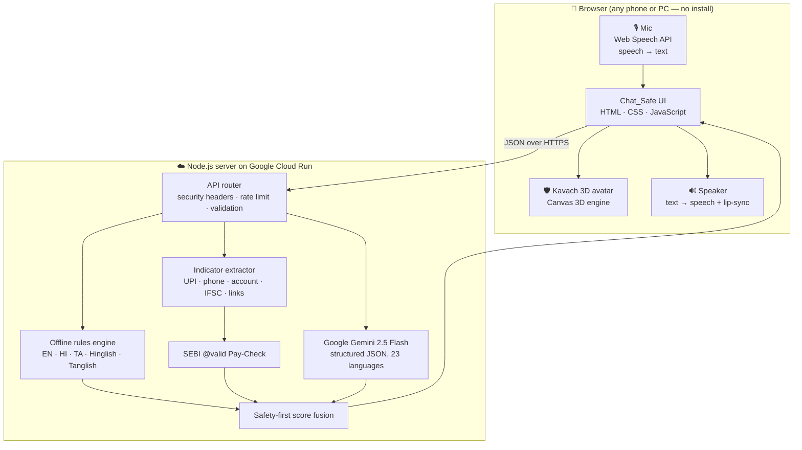
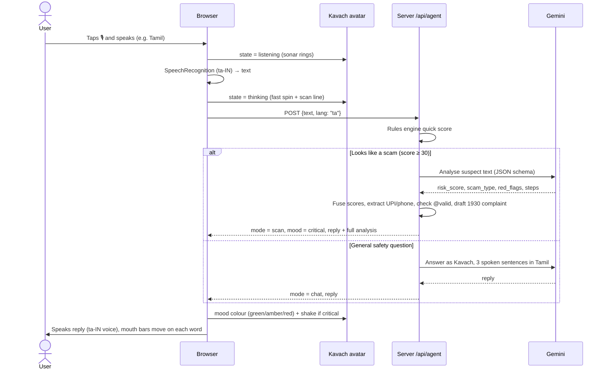

# 🛡️ Chat_Safe 2.0 — AI cyber guardian for every Indian

**PromptWars X Noor AITH — Build for Impact** · Domains: *Cybersecurity & Digital Safety* + *Accessibility & Inclusion*

Chat_Safe is a free web app where anyone can **talk** to **Kavach**, an animated 3D cyber-guardian, in **English or any of India's 22 scheduled languages**. Elders and first-time smartphone users are included: nobody needs to read English or install an app. You can speak or paste a suspicious call, WhatsApp message or payment request, and Chat_Safe will:

| Feature | What it does |
|---|---|
| 🎙️ **Kavach voice agent** | Listens (speech-to-text), checks for scams, and answers aloud (text-to-speech) with a lip-synced 3D avatar that turns green, amber or red with the threat level |
| 🔍 **Scam X-Ray** | Gives a 0–100 risk score, the scam type and the pressure tactics used (urgency, secrecy, fear, OTP requests…) |
| ✅ **Pay-Check** | Checks whether a UPI ID is a **SEBI-validated `@valid` handle** before you pay for "stock tips" or an "IPO" |
| 👵 **Kamala Paati decoy** | An AI grandma who wastes scammers' time and never shares real data (inspired by O2's *dAIsy* in the UK) |
| 📝 **1930 complaint draft** | Auto-extracts the scammer's UPI IDs, phone numbers, bank accounts, IFSC codes and links |
| 👨‍👩‍👧 **Family alert** | Sends a one-tap WhatsApp warning to a relative |
| 🌗 **Light / dark theme**, **A+ big text**, full keyboard and screen-reader support | |

---

## 1. Why this problem

- Indians lost **₹19,812 crore** to cyber fraud in 2025 across **21.7 lakh complaints** (I4C / NCRP).
- **77%** of the loss came from **fake investment groups**; digital-arrest scams were 8%.
- Telcos already block spam *calls* at network level. But a WhatsApp group asking you to pay a personal UPI ID gets through, and most safety warnings exist only in English text.

**Chat_Safe's answer:** a guardian you can *talk to* in your own language, which checks messages *and* payments.

## 2. How Chat_Safe 2.0 works

### 2.1 The big picture



### 2.2 What happens when you talk to Kavach



If Gemini is unreachable or no API key is set, the **offline rules engine and built-in answers** still work, so the demo never breaks.

### 2.3 Scoring logic

1. **Rules engine** (`src/rules.js`) matches 8 Indian scam categories and 7 pressure tactics using regular expressions in English, Hindi, Tamil, Hinglish and Tanglish. Each match adds weight. A scam word with no pressure tactic is halved, so news articles don't trigger alarms.
2. **Indicator extractor** (`src/extract.js`) finds UPI IDs, phone numbers, bank accounts, IFSC codes, amounts and risky links (shorteners, Telegram invites, `.apk` downloads).
3. **Gemini** reads the message in any language and returns a schema-checked JSON verdict.
4. **Fusion**: if either engine is ≥ 80 sure, the higher score wins (safety first). Otherwise it uses 40% rules + 60% AI.
5. Levels: `0–29 safe`, `30–59 suspicious`, `60–79 high`, `80–100 critical`.

### 2.4 How the 3D avatar works (no libraries)

`public/avatar.js` is a tiny 3D engine written from scratch:

1. Builds an **icosphere** (a 20-sided icosahedron split once, giving 42 vertices and 120 edges), which forms Kavach's shield-shaped head.
2. Every frame it **rotates** each vertex with Y/X rotation matrices, then applies **perspective projection** (`scale = d / (d − z)`).
3. Edges are drawn brighter when closer (depth shading). A tilted **ring of 72 particles** orbits the head.
4. The **visor face** follows your mouse or finger. The eyes blink, and the mouth is a 7-bar equaliser that jumps on every spoken word (`SpeechSynthesisUtterance.onboundary`).
5. **States**: idle (slow spin), listening (sonar rings, wide eyes), thinking (fast spin + scan line), speaking (mouth moves). **Mood colours**: cyan idle, green safe, amber suspicious, orange high, red critical (with a shake).
6. It respects `prefers-reduced-motion`.

### 2.5 Languages

The language picker has **English + all 22 languages of the Eighth Schedule**: Assamese, Bengali, Bodo, Dogri, Gujarati, Hindi, Kannada, Kashmiri, Konkani, Maithili, Malayalam, Manipuri, Marathi, Nepali, Odia, Punjabi, Sanskrit, Santali, Sindhi, Tamil, Telugu and Urdu.

| Layer | English, தமிழ், हिन्दी | Other 20 languages |
|---|---|---|
| Menus & buttons | Fully translated | English (a notice explains this) |
| Kavach replies, scan explanations, Paati | Gemini + offline fallback | Gemini replies in the native script; English offline fallback |
| Voice input / output | Browser speech engine | Works where the device has that voice; otherwise the reply is shown as text |
| Right-to-left scripts (Urdu, Sindhi, Kashmiri) | — | Replies display RTL automatically (`dir="auto"`) |

## 3. Programming languages & technologies used

| Language / tech | Where | Why |
|---|---|---|
| **JavaScript (Node.js 20+, CommonJS)** | Server: `server.js`, `src/*.js` | One language for front and back end; built-in `http`, `crypto`, `fetch` and `node:test` mean **zero npm dependencies** |
| **JavaScript (browser, ES2020)** | `public/app.js`, `avatar.js`, `fx.js`, `i18n.js`, `theme.js` | UI logic, 3D avatar, voice agent, animations |
| **HTML5** | `public/index.html` | Semantic, accessible page structure (ARIA tabs, live regions, meter) |
| **CSS3** | `public/styles.css` | Light/dark themes with CSS variables, glassmorphism, keyframe animations, responsive grid |
| **Regular expressions** | `src/rules.js`, `src/extract.js` | Multilingual scam-pattern and identifier detection |
| **JSON / JSON Schema** | Gemini `responseSchema`, API bodies | Structured, validated AI output |
| **Dockerfile** | `Dockerfile` | Container for Google Cloud Run |
| **Markdown + Mermaid** | `README.md` | Documentation and diagrams |

| Browser / Google APIs | Use |
|---|---|
| **Google Gemini API** (`gemini-2.5-flash`) | Scam analysis, Kavach answers, Paati replies in 23 languages |
| **Google Cloud Run** | Serverless hosting |
| **Web Speech API** | `SpeechRecognition` (voice in) and `speechSynthesis` (voice out + lip-sync) |
| **Canvas 2D API** | 3D avatar and animated cyber-mesh background |
| **Clipboard API**, **localStorage**, **PWA manifest** | Copy complaint, remember settings, install on home screen |

**Built with:** Google Antigravity / AI Studio and Claude for prompting and code generation.

## 4. Project structure

```
Chat_Safe/
├── server.js              # Starts the HTTP server, reads GEMINI_API_KEY from env
├── src/
│   ├── app.js             # Routes, security headers, rate limit, cache, /api/* handlers
│   ├── rules.js           # Offline multilingual scam rules + score fusion
│   ├── extract.js         # UPI / phone / account / IFSC / link extractor
│   ├── upiCheck.js        # SEBI @valid Pay-Check
│   ├── gemini.js          # Gemini client: analyse, agentReply, decoyReply
│   ├── languages.js       # 23 languages with speech codes + RTL flags
│   └── content.js         # Offline verdicts, steps, FAQ answers, Paati lines, 1930 draft
├── public/
│   ├── index.html         # Page
│   ├── styles.css         # Themes + animations
│   ├── theme.js           # Applies saved light/dark theme before first paint
│   ├── i18n.js            # UI text (English, Tamil, Hindi)
│   ├── avatar.js          # Kavach 3D avatar engine
│   ├── fx.js              # Animated cyber-mesh background
│   └── app.js             # Voice agent, scan, Pay-Check, Paati, tabs
├── test/                  # 54 automated tests (node:test)
├── Dockerfile · .env.example · LICENSE
```

## 5. Run it

```bash
# Needs Node.js 20 or newer — no npm install required
cp .env.example .env       # add GEMINI_API_KEY (optional — works offline without it)
npm run dev                # open http://localhost:8080 in Chrome or Edge
npm test                   # run all tests
npm run coverage           # coverage report
```

**Deploy to Google Cloud Run**

```bash
gcloud run deploy chat-safe --source . --region asia-south1 --allow-unauthenticated \
  --set-env-vars GEMINI_MODEL=gemini-2.5-flash,GEMINI_API_KEY=<your-key>
```

## 6. API

| Method | Path | Body | Returns |
|---|---|---|---|
| GET | `/api/health` | — | `{ ok, ai }` |
| GET | `/api/languages` | — | 23 languages with native names and speech codes |
| POST | `/api/agent` | `{ text, lang, turn }` | `{ mode: scan\|chat, mood, reply, analysis? }` |
| POST | `/api/analyze` | `{ text, lang }` | score, level, verdict, scamType, redFlags, nextSteps, indicators, upiChecks, complaint |
| POST | `/api/upi-check` | `{ upi }` | `validated-format` / `not-validated` / `invalid` |
| POST | `/api/decoy` | `{ text, lang, turn }` | `{ reply, engine }` |

## 7. Quality checklist

- **Security**: strict Content-Security-Policy (no inline scripts, no third-party code), `X-Frame-Options: DENY`, `nosniff`, HSTS, no-referrer. 16 KB body limit, 4,000-char text limit, control-character stripping, per-IP rate limit, path-traversal-safe static server. The API key is read only from the environment and sent in a header. Prompt-injection guard: user text is wrapped in tags, treated as data, and model output is schema-checked. The Docker image runs as a non-root user, and the DOM is built with `textContent` only.
- **Efficiency**: zero dependencies, a SHA-256-keyed LRU cache (repeat scans skip the AI call), a 12-second AI timeout with offline fallback, and animations capped at 2× device pixel ratio that pause in background tabs.
- **Testing**: 54 `node:test` unit and HTTP integration tests. They cover multilingual detection, all 23 languages, the agent's scan and chat modes, AI failure fallback, caching, rate limiting, input validation, security headers and path traversal.
- **Accessibility**: skip link, WAI-ARIA tabs with arrow keys, `role="meter"` gauge, `aria-live` chat, 46px+ touch targets, big-text mode, light/dark themes, `prefers-reduced-motion`, voice in and out, and RTL support.

## 8. Demo script (2 minutes)

1. **Hook**: "77% of India's ₹19,812 crore cyber-fraud loss last year came from fake investment groups. Most victims never read an English warning."
2. Tap 🎙️ and say *"CBI officer says digital arrest, don't tell family, transfer money now"*. Kavach turns **red**, shakes, and speaks the warning.
3. Switch the language to **தமிழ்** and tap *"What is a digital arrest?"*. Kavach answers aloud in Tamil.
4. **Scan a message** → *Stock-tip group* → the score counts up to **Critical**, and the personal UPI ID is flagged against SEBI `@valid`.
5. **Check before you pay**: `rajesh.trader@ybl` ❌ vs `abc.brk@validhdfc` ✅.
6. **Paati decoy**: paste *"Send OTP now"* and watch Paati ramble about her pressure cooker.
7. Toggle 🌙 / ☀️ and pick **Urdu** to show right-to-left support. End on the auto-filled **1930 complaint**.

## 9. Acknowledgements

SEBI (Validated UPI Handles & SEBI Check), I4C / National Cyber Crime Reporting Portal (1930), DoT Sanchar Saathi (Chakshu), Google Gemini API, Web Speech API. The decoy idea was inspired by Virgin Media O2's *dAIsy* and Apate.ai. No third-party code or datasets are bundled.

## 10. Roadmap

- IVR voice call for feature-phone users (Exotel/Twilio) using the same `/api/agent`
- Bhashini speech models for languages that browsers can't speak yet (Bodo, Santali, Manipuri…)
- Screenshot upload (Gemini multimodal) to read WhatsApp screenshots directly

---
*Chat_Safe gives guidance, not legal or financial advice. In an emergency call **1930** or **112**.*
