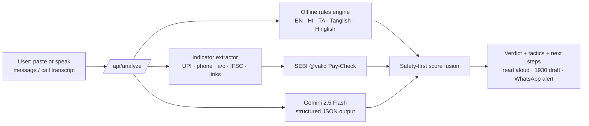

# 🛡️ Chat_Safe — Scam X-Ray for every Indian

**PromptWars X Noor AITH — Build for Impact** · Domain: *Cybersecurity & Digital Safety* + *Accessibility & Inclusion*

Chat_Safe is a free, multilingual AI tool that lets anyone (including elders and people who struggle to read) paste or **speak** a suspicious message or call and instantly get:

1. **Scam X-Ray**: a 0–100 risk score, the scam type, and the pressure tactics being used, read aloud in **English, தமிழ் or हिन्दी** (Tanglish and Hinglish also work).
2. **Pay-Check**: verifies whether the UPI ID you're asked to "invest" through is a **SEBI-validated `@valid` handle**.
3. **Kamala Paati decoy**: an AI grandma who **wastes scammers' time** with polite, rambling replies and never shares any real data.
4. **1930 complaint draft**: auto-extracts the scammer's UPI IDs, phone numbers, bank accounts, IFSC codes and links into a ready-to-paste complaint for cybercrime.gov.in.
5. **One-tap family alert** on WhatsApp.

---

## 1. The problem

- Indians lost **₹19,812 crore** to cyber fraud in 2025 across **21.7 lakh complaints** (I4C / NCRP).
- **77%** of that loss came from **fake investment schemes** (WhatsApp/Telegram "VIP stock-tip" groups), against **8%** from "digital arrest".
- Telcos such as Airtel already block spam *calls* at network level. But a scam that arrives as a **WhatsApp group message asking you to pay a personal UPI ID** gets through, and many victims cannot read English warnings.

## 2. What makes Chat_Safe different

| Idea | Inspired by | In India before? |
|---|---|---|
| AI grandma scam-baiter ("Paati") | O2 **dAIsy** (UK, 2024), **Apate.ai** (Australia) | Not to our knowledge |
| Pay-Check against SEBI `@valid` UPI rule (live since 1 Oct 2025) | SEBI PR 64/2025 | No consumer AI tool combines it with scam detection |
| Hybrid engine: offline rules + Gemini | — | Works with **no internet AI / no key**, so it never fails in a demo |
| Voice in, voice out, in Indian languages | — | Built for low-literacy users |

## 3. How it works



- **Score fusion**: if either engine is ≥80 confident, the higher score wins (safety first). Otherwise it's a 40/60 blend of rules and AI.
- **Prompt-injection guard**: suspect text is wrapped in `<suspect>` tags and the model is told to treat it as data. Output is schema-constrained and re-validated server-side.
- **Paati guardrails**: she never gives digits, OTPs, account data or payments, never insults, and always ends with a question that keeps the scammer explaining.

## 4. Tech stack & AI tools

| Layer | Choice |
|---|---|
| AI | **Google Gemini API** (`gemini-2.5-flash`), structured output with `responseSchema` |
| Hosting | **Google Cloud Run** (Dockerfile included) |
| Backend | Node.js 20+ built-ins only (`node:http`, `fetch`, `node:test`). **Zero npm dependencies**, so nothing in the supply chain to attack |
| Frontend | Vanilla HTML/CSS/JS, installable PWA, Web Speech API for voice input and read-aloud |
| Built with | Google Antigravity / AI Studio + Claude for prompting & code generation |

**Third-party acknowledgements:** SEBI (Validated UPI Handles & SEBI Check), I4C / National Cyber Crime Reporting Portal (1930), DoT Sanchar Saathi (Chakshu). The O2 dAIsy and Apate.ai concepts inspired the decoy feature. No third-party code or datasets are bundled.

## 5. Run it

```bash
# Node 20+ — no npm install needed
cp .env.example .env          # add GEMINI_API_KEY (optional — works offline without it)
npm run dev                   # http://localhost:8080
npm test                      # 45+ tests
npm run coverage              # line coverage report
```

### Deploy to Cloud Run

```bash
gcloud run deploy chat-safe --source . --region asia-south1 --allow-unauthenticated \
  --set-env-vars GEMINI_MODEL=gemini-2.5-flash \
  --set-secrets GEMINI_API_KEY=gemini-api-key:latest
```

## 6. API

| Method | Path | Body | Returns |
|---|---|---|---|
| GET | `/api/health` | — | `{ ok, ai }` |
| POST | `/api/analyze` | `{ text, lang: "en"\|"ta"\|"hi" }` | score, level, verdict, scamType, redFlags, nextSteps, indicators, upiChecks, complaint |
| POST | `/api/upi-check` | `{ upi }` | verdict `validated-format` / `not-validated` / `invalid` |
| POST | `/api/decoy` | `{ text, lang, turn }` | `{ reply, engine }` |

## 7. Quality checklist

- **Security**: strict CSP, `X-Frame-Options: DENY`, `nosniff`, HSTS, `Referrer-Policy`; 16 KB body limit; 4,000-char text limit; control-char stripping; per-IP rate limit (30/min); path-traversal-safe static server; API key only from env and sent in a header (never in the URL); non-root Docker user; DOM built with `textContent` only (no `innerHTML`).
- **Efficiency**: pre-compiled regexes, SHA-256-keyed LRU cache (repeat checks don't cost an AI call), 12 s AI timeout with offline fallback, static asset caching, tiny repo.
- **Testing**: `node:test` unit and HTTP integration tests covering multilingual detection, edge cases (empty/garbage/huge input), AI failure fallback, caching, rate limiting, LRU eviction, header and traversal checks.
- **Accessibility**: skip link, WAI-ARIA tabs with arrow-key navigation, `role="meter"` gauge with `aria-valuetext`, `aria-live` results, 48px touch targets, **big-text** and **high-contrast** modes, reduced-motion support, voice input and read-aloud in en-IN / ta-IN / hi-IN.

## 8. Demo script (2 minutes)

1. **Hook**: "77% of India's ₹19,812 crore cyber-fraud loss last year was fake investment groups, not phone calls."
2. Tap **Stock-tip group** → **Check**. Score 88, *Critical*. The personal UPI ID is flagged against SEBI's `@valid` rule.
3. Switch the language to **தமிழ்** → **Read aloud**: the verdict is spoken in Tamil.
4. **Check before you pay**: `rajesh.trader@ybl` gives ❌, `abc.brk@validhdfc` gives ✅.
5. **Paati decoy**: paste "Send OTP now", and Paati rambles about her pressure cooker.
6. Show the auto-filled **1930 complaint** and **WhatsApp family alert**.

## 9. Roadmap

- IVR voice call for feature-phone users (Twilio/Exotel). Bhashini for 22 languages.
- Screenshot upload (Gemini multimodal) to read WhatsApp screenshots directly.
- Opt-in shared scam-indicator feed, aggregated for police reporting.

---
*Chat_Safe gives guidance, not legal or financial advice. In an emergency call **1930** or **112**.*
